# API → Frontend Handoff Roadmap

This is the execution tracker for making the Mock Trader API safe and stable
enough for frontend implementation. Work through the phases in order. Do not
mark a phase complete until every exit criterion for that phase passes.

## Current assessment

**Overall status:** Ready for MVP frontend integration; production rollout is
still gated by staging email/provider credentials and Phase 7 operational work.

**Current strengths:** The MVP scope is frozen, verified users receive exactly
one INR practice account and ledger credit, market buy/sell flows are safe under
concurrency and retries, the frontend contract/client are generated, the live
HTTP smoke passes, 19 default tests pass, and the PostgreSQL integration suite
passes when enabled.

**Remaining production gates:** Configure and verify the production email
provider, exercise provider-outage/load/restore drills, complete operational
alerting and backups, and explicitly approve any post-MVP feature before adding
it to the public contract. Historical charts, account reset, competitions, and
watchlists are intentionally deferred by `MVP_SCOPE.md`.

## Status legend

| Status | Meaning |
|---|---|
| ⬜ Not started | No implementation work has started. |
| 🟡 In progress | Actively being implemented. |
| 🔴 Blocked | Cannot continue until a dependency or decision is resolved. |
| 🟢 Done | Implemented, tested, documented, and accepted. |
| ⚪ Deferred | Explicitly outside the frozen MVP contract. |

When work begins, update the status in the tables and add the owner. A task is
not done merely because code was written; its acceptance criteria must pass.

## Critical path

```mermaid
flowchart LR
    A[Phase 0<br/>Lock product decisions] --> B[Phase 1<br/>Fix API foundation]
    B --> C[Phase 2<br/>Provision user accounts]
    C --> D[Phase 3<br/>Make trading correct]
    D --> E[Phase 4<br/>Freeze API contract]
    E --> F[Phase 5<br/>Harden realtime data]
    F --> G[Phase 6<br/>Complete product APIs]
    G --> H[Phase 7<br/>Security and operations]
    H --> I[Phase 8<br/>Frontend handoff]
```



## Recommended execution order

| Order | Phase | Goal | Frontend impact |
|---:|---|---|---|
| 1 | Phase 0 | Lock decisions that affect every contract. | Frontend can build visual prototypes only. |
| 2 | Phase 1 | Make the service boot, migrate, and report readiness correctly. | Frontend can use mocks, not live integration. |
| 3 | Phase 2 | Make signup produce a usable practice account. | Auth and onboarding integration can begin after exit. |
| 4 | Phase 3 | Make balances, orders, and portfolios trustworthy. | Core trading screens can integrate after exit. |
| 5 | Phase 4 | Publish a stable, generated API contract. | Full frontend implementation can begin safely. |
| 6 | Phase 5 | Make WebSocket and charts reliable. | Live market screens can integrate. |
| 7 | Phase 6 | Fill out remaining product workflows. | Competition/history/watchlist screens can integrate. |
| 8 | Phase 7 | Make production operation safe. | Staging and production rollout become viable. |
| 9 | Phase 8 | Prove the contract and hand it over. | Frontend owns feature implementation against a frozen API. |

---

## Phase 0 — Lock product and deployment decisions

**Goal:** Remove ambiguity before changing API contracts.

| ID | Task / decision | Recommended choice | Owner | Status |
|---|---|---|---|---|
| D-01 | Decide the MVP order types. | Market + day only; all conditional types are rejected. | Backend | 🟢 Done |
| D-02 | Decide frontend/backend hosting. | Local origins are explicit; production uses one reverse-proxied public origin. | Backend | 🟢 Done |
| D-03 | Confirm account currency. | INR for practice accounts and instruments. | Product | 🟢 Done |
| D-04 | Choose authentication methods for MVP. | Google plus verified email/password. | Product | 🟢 Done |
| D-05 | Decide initial practice balance and reset policy. | ₹10,00,000; reset is deferred from MVP. | Product | 🟢 Done |
| D-06 | Define public leaderboard identity. | Competitions/leaderboards are disabled in the MVP contract. | Product | 🟢 Done |
| D-07 | Decide whether watchlists are MVP. | Deferred from MVP. | Product | 🟢 Done |

### Phase 0 exit criteria

- [x] Every decision above is recorded.
- [x] MVP features and explicitly deferred features are documented.
- [x] API naming, currency, timezone, decimal serialization, and deployment
      origin conventions are agreed by backend and frontend leads.

---

## Phase 1 — Repair the API foundation

**Goal:** Ensure the service boots predictably and exposes one unambiguous API.

| ID | Task | Depends on | Owner | Status | Acceptance criteria |
|---|---|---|---|---|---|
| F-01 | Remove all duplicate market-route registrations. | — | Backend | 🟢 Done | Each method/path pair is registered exactly once. |
| F-02 | Regenerate migrations and include `audit_log`. | — | Backend | 🟢 Done | Clean isolated PostgreSQL migration verified. |
| F-03 | Remove or reconcile the duplicate `app_settings` migration. | F-02 | Backend | 🟢 Done | Duplicate migration removed; repeated migration verified. |
| F-04 | Add PostgreSQL to `/ready`. | — | Backend | 🟢 Done | Live readiness smoke includes PostgreSQL. |
| F-05 | Document and validate required production environment variables. | D-02, D-04 | Backend | 🟢 Done | `.env.example` includes auth, origins, database, Redis, Paytm, and email settings. |
| F-06 | Configure CORS, credentialed cookies, trusted origins, secure cookies, and proxy trust. | D-02 | Backend | 🟢 Done | Approved origins and credentialed auth are configured. |
| F-07 | Replace console-only email with a production email provider. | D-04 | Ops | 🟡 In progress | Resend delivery is implemented; staging credentials/domain verification remain external. |
| F-08 | Make the route-verification script fail on connection or status errors. | — | Backend | 🟢 Done | Live smoke exits non-zero on failures and passed locally. |
| F-09 | Fix current lint errors and enforce lint/typecheck/test in CI. | — | Backend | 🟢 Done | API/frontend checks and generated-contract diff are in CI. |

### Phase 1 exit criteria

- [ ] A clean Postgres + Redis environment boots with one documented command.
- [ ] Migrations apply successfully from zero and on a previous schema.
- [ ] Health and readiness checks correctly reflect dependencies.
- [ ] Signup verification and password reset work in staging.
- [ ] Tests, typecheck, lint, migration checks, and route checks all pass.

---

## Phase 2 — Complete user onboarding and account lifecycle

**Goal:** A newly verified user can immediately use the mock-trading product.

| ID | Task | Depends on | Owner | Status | Acceptance criteria |
|---|---|---|---|---|---|
| A-01 | Automatically create one practice account after verified signup, or provide an idempotent `POST /me/accounts`. | D-03, D-05, F-02 | Backend | 🟢 Done | Bootstrap and explicit retry provision exactly one account/credit. |
| A-02 | Add `GET /api/v1/me` bootstrap endpoint. | A-01 | Backend | 🟢 Done | Public profile, capabilities, onboarding, account, currency, and flags returned. |
| A-03 | Add account-detail endpoint. | A-01 | Backend | 🟢 Done | Owned public account and summary returned. |
| A-04 | Add idempotent account reset workflow. | D-05, A-01 | Product | 🟢 Done | Explicitly deferred from MVP and advertised as disabled. |
| A-05 | Define suspended/restricted/banned user behavior consistently. | A-02 | Backend | 🟢 Done | Bans block access; non-active trading status blocks new orders; account status is enforced transactionally. |

### Phase 2 exit criteria

- [ ] The end-to-end flow `signup → verify → session → practice account → portfolio`
      works on an empty database.
- [ ] Repeating provisioning/reset requests cannot duplicate money or accounts.
- [ ] The frontend has one bootstrap endpoint for routing and onboarding state.

---

## Phase 3 — Make trading and portfolio calculations correct

**Goal:** Every visible balance, position, and order state is trustworthy.

| ID | Task | Depends on | Owner | Status | Acceptance criteria |
|---|---|---|---|---|---|
| T-01 | Implement real idempotent order replay. | A-01 | Backend | 🟢 Done | Same account/key/payload returns the original response; same key with a different payload returns 409. |
| T-02 | Scope idempotency keys by account instead of globally. | T-01 | Backend | 🟢 Done | Different accounts may safely use the same client-generated key. |
| T-03 | Lock the supported MVP order matrix. | D-01 | Backend | 🟢 Done | Unsupported type/TIF combinations return a documented 400. |
| T-04 | Build conditional-order matcher and expiry worker, or temporarily reject non-market orders. | D-01, T-03 | Backend | 🟢 Done | Non-market and non-day orders are rejected; no MVP order can remain open indefinitely. |
| T-05 | Value positions using current quotes. | — | Backend | 🟢 Done | Market value, unrealized P&L, equity, and return use a quote with timestamp/staleness metadata. |
| T-06 | Add snapshot and leaderboard calculation jobs. | T-05 | Product | ⚪ Deferred | Historical charts and leaderboards are outside the MVP contract. |
| T-07 | Validate market tradability, quote staleness, market hours, lot size, tick size, freeze quantity, and price bands. | D-03 | Backend | 🟢 Done | Fresh provider tradability plus instrument constraints are checked before the transaction mutates cash or inventory. |
| T-08 | Define execution policy: price source, fees, slippage, and partial-fill behavior. | D-01 | Backend | 🟢 Done | The simulator rules are documented and deterministic in tests. |
| T-09 | Add order detail and order replace/modify endpoint if conditional orders ship. | T-04 | Product | ⚪ Deferred | Conditional orders are outside the MVP contract. |
| T-10 | Add account cash-ledger/activity endpoint. | A-01 | Backend | 🟢 Done | Every balance change is explainable to the user. |

### Phase 3 exit criteria

- [x] Concurrent orders cannot overspend cash or oversell inventory.
- [x] Retried requests never duplicate trades, reservations, or ledger entries.
- [x] Portfolio values match independently calculated expected values.
- [x] Every advertised order type reaches a terminal state correctly.
- [x] Trading integration tests run against real PostgreSQL transactions.

---

## Phase 4 — Freeze a frontend-safe API contract

**Goal:** Give the frontend one accurate, generated, stable contract.

| ID | Task | Depends on | Owner | Status | Acceptance criteria |
|---|---|---|---|---|---|
| C-01 | Add route-level request and response schemas. | Phases 1–3 | Backend | 🟡 In progress | MVP inputs are runtime-validated and represented in OpenAPI; consolidating those definitions into one schema source is post-handoff cleanup. |
| C-02 | Introduce explicit public DTOs; stop returning raw DB rows. | C-01 | Backend | 🟢 Done | Session IDs, IPs, device fingerprints, internal user IDs, raw risk fields, and upstream payloads are absent. |
| C-03 | Standardize error envelopes and stable error codes. | C-01 | Backend | 🟢 Done | MVP custom routes return `{ error: { code, message, requestId } }`; Better Auth owns auth-route errors. |
| C-04 | Add cursor pagination, filtering, and sorting. | C-01 | Backend | 🟢 Done | The MVP orders, trades, and activity collections are bounded and cursor-paginated. |
| C-05 | Bound and validate market queries. | C-01 | Backend | 🟢 Done | IDs, limits, intervals, date ranges, modes, and provider parameters have explicit constraints. |
| C-06 | Return per-instrument results/errors for bulk quotes. | C-01 | Backend | 🟢 Done | Unknown symbols do not silently disappear. |
| C-07 | Merge the complete Better Auth schema into the canonical spec. | F-07, C-01 | Backend | 🟢 Done | Auth is represented by concrete operations, not `/auth/{path}`. |
| C-08 | Make version, base path, servers, examples, and Markdown docs agree. | C-01 | Backend | 🟢 Done | The canonical docs use API version 2.0.0 and base path `/api/v1`. |
| C-09 | Generate and publish a typed TypeScript client. | C-01–C-08 | Backend | 🟢 Done | The frontend builds with generated OpenAPI types and `openapi-fetch`. |
| C-10 | Add contract-diff CI. | C-09 | Backend | 🟢 Done | CI regenerates the spec/client and rejects an uncommitted diff. |

### Phase 4 exit criteria

- [x] There is one canonical OpenAPI artifact.
- [x] The running service conforms to it in route smoke and integration tests.
- [x] Frontend can authenticate and call every MVP operation using the generated client.
- [x] Examples cover success, validation failure, unauthenticated, forbidden,
      conflict, stale-data, and upstream-unavailable responses.

**Frontend integration gate:** Full frontend integration should begin only after
this phase. Earlier frontend work should use mocks generated from the draft
contract.

---

## Phase 5 — Harden WebSocket and market data

**Goal:** Make live data secure, mode-correct, reconnectable, and observable.

| ID | Task | Depends on | Owner | Status | Acceptance criteria |
|---|---|---|---|---|---|
| W-01 | Authenticate WebSocket connections or issue short-lived socket tickets. | A-02, F-06 | Backend | 🟢 Done | Better Auth cookie sessions are required; anonymous or expired connections are rejected. |
| W-02 | Validate WebSocket origin, payload size, connection count, and message rate. | W-01 | Backend | 🟡 In progress | Origin, 16 KiB payload, 30 messages/second, and subscription limits are enforced; deployment-wide connection limiting remains operational hardening. |
| W-03 | Fan out quotes by subscription key, including mode, not only instrument. | — | Backend | 🟢 Done | LTP subscribers never receive FULL events unless requested. |
| W-04 | Add message IDs, stable error codes, heartbeat rules, and a documented reconnect/resubscribe protocol. | C-03 | Backend | 🟢 Done | Requests are correlated, errors are stable, and the frontend handoff guide documents reconnect/resubscribe behavior. |
| W-05 | Restore active subscription leases after worker restart. | — | Backend | ⬜ Not started | Existing clients resume receiving data without manual resubscribe. |
| W-06 | Decide and implement candle-history source. | D-01 | Product | 🟢 Done | Paytm Money serves daily candles; Yahoo Finance serves intraday candles and fallback. |
| W-07 | Remove raw provider payload from public quote events. | C-02 | Backend | 🟢 Done | Public events contain only the normalized schema. |
| W-08 | Consolidate the two price-ingest worker implementations. | — | Backend | ⬜ Not started | One worker, one Redis contract, one deployment path, one set of docs. |

### Phase 5 exit criteria

- [ ] Live quote mode and symbol routing are correct under concurrent subscriptions.
- [ ] Reconnect and worker restart tests pass.
- [ ] Anonymous flooding and oversized payload tests are rejected safely.
- [ ] Historical and live chart behavior is documented and reliable.

---

## Phase 6 — Complete remaining product APIs

**Goal:** Support the complete planned frontend instead of only the trading core.

| ID | Task | Required for MVP? | Owner | Status | Acceptance criteria |
|---|---|---:|---|---|---|
| P-01 | Competition detail endpoint. | Yes, if competitions ship | TBD | ⬜ Not started | Includes rules, schedule, status, limits, and participation state. |
| P-02 | Competition join, leave, and “my participation” endpoints. | Yes, if competitions ship | TBD | ⬜ Not started | State transitions and account provisioning are idempotent. |
| P-03 | Portfolio/equity history endpoint. | Recommended | TBD | ⬜ Not started | Returns bounded time-series data with interval selection. |
| P-04 | Market-session/status endpoint. | Recommended | TBD | ⬜ Not started | Returns timezone, open/closed state, next transition, and quote freshness. |
| P-05 | User watchlist CRUD. | Decision D-07 | TBD | ⬜ Not started | Owned, ordered watchlists support bulk quote hydration. |
| P-06 | Notification/preferences API. | Optional | TBD | ⬜ Not started | Only add when a real notification channel exists. |
| P-07 | Admin competition creation/finalization APIs. | Admin release | TBD | ⬜ Not started | Admins can operate competitions without direct DB changes. |

### Phase 6 exit criteria

- [ ] Every approved frontend screen maps to documented API operations.
- [ ] Deferred screens/features are explicitly identified to frontend.
- [ ] No production workflow requires manual database insertion.

---

## Phase 7 — Production security and operations

**Goal:** Make staging and production failures bounded, diagnosable, and recoverable.

| ID | Task | Owner | Status | Acceptance criteria |
|---|---|---|---|---|
| O-01 | Add rate limits to auth, quote refresh, chart proxy, orders, admin, and WebSockets. | TBD | ⬜ Not started | Limits return documented 429 responses and metrics. |
| O-02 | Add Paytm request timeout, bounded retry, and circuit breaker. | TBD | ⬜ Not started | A provider outage cannot indefinitely occupy API resources. |
| O-03 | Stop returning upstream/database exception text to clients. | TBD | ⬜ Not started | Clients receive safe errors; detailed causes remain only in protected logs. |
| O-04 | Add structured logs, request IDs, metrics, and alerting. | TBD | ⬜ Not started | A failed order can be traced across API, DB, Redis, and worker. |
| O-05 | Add graceful shutdown. | TBD | ⬜ Not started | HTTP, Redis, PostgreSQL, timers, workers, and telemetry drain cleanly. |
| O-06 | Add container healthchecks, restart policies, dependency health conditions, and migration job. | TBD | ⬜ Not started | Compose/staging starts consistently and recovers from process failure. |
| O-07 | Define backup, restore, retention, and secret-rotation procedures. | TBD | ⬜ Not started | Restore drill and secret rotation are documented and tested. |
| O-08 | Review public/admin data exposure and audit all privileged mutations. | TBD | ⬜ Not started | Admin actions have actor, request ID, reason, before/after state, and timestamp. |

### Phase 7 exit criteria

- [ ] Load and abuse tests stay within agreed error and latency budgets.
- [ ] Provider, Redis, Postgres, worker, and email outages degrade predictably.
- [ ] Dashboards and alerts cover availability, error rate, latency, stale quotes,
      rejected orders, worker disconnects, and queue/backlog health.
- [ ] Backup restore and rollback procedures have been exercised.

---

## Phase 8 — Frontend handoff and release gate

**Goal:** Give the frontend team a stable package and prove it works end-to-end.

| ID | Deliverable | Owner | Status | Acceptance criteria |
|---|---|---|---|---|
| H-01 | Versioned OpenAPI file and generated TypeScript client. | Backend | 🟢 Done | Versioned artifacts are checked in and regenerated/diffed in CI. |
| H-02 | Frontend integration guide. | Backend | 🟢 Done | Covers base URLs, cookies/CORS, auth, errors, decimals, pagination, WebSocket reconnects, and environments. |
| H-03 | Seed script and test accounts. | Backend | 🟢 Done | `bun run seed:demo` creates deterministic non-production credentials without direct SQL. |
| H-04 | Postman/Bruno collection or executable API examples. | Backend | 🟢 Done | The executable HTTP verifier is checked against the canonical routes. |
| H-05 | End-to-end smoke suite. | Backend | 🟡 In progress | The full journey passed manually against isolated Postgres/Redis; automating the authenticated journey remains. |
| H-06 | Failure-path suite. | Backend | 🟡 In progress | Database tests cover retries, no cash/inventory, concurrency, and stale/invalid quotes; provider outage/reconnect drills remain. |
| H-07 | Contract sign-off. | Backend + Frontend | 🟡 In progress | The MVP contract is frozen in-repo; frontend lead acceptance remains. |

### Final release checklist

- [ ] All Phase 0–7 exit criteria pass.
- [ ] No P0 or P1 defects remain open.
- [ ] Test, typecheck, lint, migration, contract, integration, and smoke suites pass.
- [ ] A fresh environment can be deployed using documented commands only.
- [ ] The generated frontend client matches the deployed API version.
- [ ] Staging auth, email, trading, portfolio, charts, and WebSocket flows pass.
- [ ] Rollback procedure is documented and tested.

## Suggested milestone grouping

| Milestone | Included phases | Definition of done |
|---|---|---|
| M1 — Stable backend foundation | 0–1 | Clean deployment, migrations, auth email, readiness, CI. |
| M2 — Tradable user journey | 2–3 | A new user can safely complete market buy/sell flows with correct balances. |
| M3 — Contract freeze | 4 | Canonical OpenAPI and generated client are approved. |
| M4 — Realtime and feature completion | 5–6 | Live market and approved frontend screens are fully supported. |
| M5 — Production readiness | 7–8 | Operations, security, end-to-end verification, and handoff are complete. |

## Weekly tracking template

Copy this section for each weekly review:

```md
### Week of YYYY-MM-DD

- Current milestone:
- Completed IDs:
- In-progress IDs:
- Blocked IDs and reasons:
- Decisions required:
- Contract changes made:
- Test/CI status:
- Target for next week:
```

## Definition of done for every API task

A task can be marked 🟢 only when all applicable items are true:

- [ ] Implementation is complete.
- [ ] Request and response schemas are defined.
- [ ] Authorization and ownership checks are present.
- [ ] Success and failure tests pass.
- [ ] OpenAPI and examples are updated.
- [ ] Generated client compiles.
- [ ] Logs/metrics contain enough context to operate it.
- [ ] No sensitive/internal fields are exposed.
- [ ] Backward compatibility or versioning impact was reviewed.
